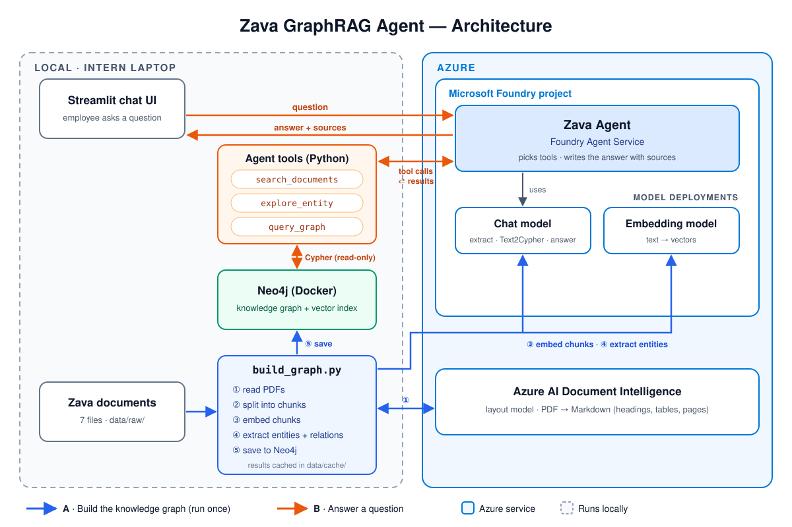

# Zava GraphRAG Agent — Internship Project

An internship project to build a **GraphRAG AI agent** on Azure, using **Microsoft Foundry**, **Foundry Agent Service**, **Azure AI Document Intelligence** and **Neo4j**.

**GraphRAG** adds a knowledge graph to normal RAG. The LLM turns documents into entities and relationships, which are stored in a graph. Questions are then answered using both similar text and connected facts from the graph. This helps with questions that plain RAG struggles with, such as comparisons and "list all…" questions.

> 📋 **Full plan, architecture and weekly tasks:** [`docs/PLAN.md`](docs/PLAN.md)
>
> **Status:** 🟡 Kickoff. The folders and commands below are planned and don't exist yet.

---

## Goal

Build an **AI agent** for **Zava**, a fictional company, that answers employee questions about **roles, policies and benefits**. It answers only from Zava's documents and shows its sources. The agent uses tools to search a Neo4j knowledge graph and chooses the right tool for each question. Then show that GraphRAG answers better than plain RAG.

---

## Architecture



| Part | Service / tool |
|---|---|
| AI platform | **Microsoft Foundry** project (formerly Azure AI Foundry) |
| Models | Chat model + embedding model, deployed in Foundry |
| Agent | **Foundry Agent Service**, with tools: `search_documents`, `explore_entity`, `query_graph` |
| PDF reading | **Azure AI Document Intelligence** (layout model) |
| Graph + vector database | **Neo4j** in Docker, locally |
| Code | **Python 3.12** with **uv**, `azure-ai-projects` SDK, `neo4j` driver |
| Chat UI | **Streamlit** |

The app and Neo4j run locally. The AI services run in Azure. Details are in [`docs/PLAN.md`](docs/PLAN.md#2-architecture).

---

## Data

We use the sample documents from Microsoft's official Azure RAG sample, [`Azure-Samples/azure-search-openai-demo`](https://github.com/Azure-Samples/azure-search-openai-demo/tree/main/data). They describe **Zava**, a fictional company. MIT license, 7 files, about 4 MB.

| File | Content |
|---|---|
| `Zava_Company_Overview.md` | What the company is and does |
| `employee_handbook.pdf` | Company policies, rules, processes |
| `role_library.pdf` | Job roles, responsibilities, skills |
| `Benefit_Options.pdf` | Overview of employee benefits |
| `Northwind_Health_Plus_Benefits_Details.pdf` | Premium health plan details |
| `Northwind_Standard_Benefits_Details.pdf` | Standard health plan details |
| `PerksPlus.pdf` | Employee perks programme |

### Graph model (starting point)

```
(Document)-[:HAS_CHUNK]->(Chunk)          // text + embedding
(Chunk)-[:MENTIONS]->(entity)             // links facts to their source

(Role)-[:BELONGS_TO]->(Department)
(Role)-[:REQUIRES]->(Skill)
(Policy)-[:APPLIES_TO]->(Role)
(Plan)-[:COVERS]->(Service)
```

### Example questions

| Question | Why the graph helps |
|---|---|
| Which services does Health Plus cover that Standard doesn't? | Compares two documents |
| What skills do engineering roles have in common? | Collects facts from many roles |
| Which policies apply to managers? | Follows relationships |

---

## Project structure (planned)

```
internship/
├── src/graphrag/       # config, documents, models, extract, graph, tools, agent
├── scripts/            # download_data.py, build_graph.py, ask.py
├── app.py              # Streamlit chat UI
├── evaluation/         # Test questions + comparison script
├── data/               # raw/ documents + cache/ of saved results (not in git)
└── docs/               # PLAN.md, graph schema, weekly notes
```

---

## Getting started

### You need
- Python 3.12+ and [uv](https://docs.astral.sh/uv/)
- [Docker](https://www.docker.com/) (for Neo4j)
- [Azure CLI](https://learn.microsoft.com/cli/azure/install-azure-cli), signed in with `az login`
- Access to the team's **Foundry project** and **Document Intelligence** resource (from the lead)

### Setup (planned)

Install dependencies:
```bash
uv sync
```

Create your local config and fill in the values:
```bash
cp .env.example .env
```

Start Neo4j:
```bash
docker run -d --name neo4j -p 7474:7474 -p 7687:7687 -e NEO4J_AUTH=neo4j/<password> neo4j:5
```

Download the documents:
```bash
uv run python scripts/download_data.py
```

Build the graph:
```bash
uv run python scripts/build_graph.py
```

Start the chat UI:
```bash
uv run streamlit run app.py
```

### `.env`
```env
NEO4J_URI=bolt://localhost:7687
NEO4J_USERNAME=neo4j
NEO4J_PASSWORD=

# Microsoft Foundry
FOUNDRY_PROJECT_ENDPOINT=
FOUNDRY_CHAT_DEPLOYMENT=
FOUNDRY_EMBEDDING_DEPLOYMENT=

# Document Intelligence
DOCINTEL_ENDPOINT=
DOCINTEL_KEY=
```

> ⚠️ Never commit `.env`. It's in `.gitignore`.

---

## Roadmap (5 weeks)

| Weeks | Focus | Done when |
|---|---|---|
| 1 | Setup: Foundry project, models, Document Intelligence, Neo4j | Everyone can run Neo4j and call a Foundry model |
| 2 | Learn Neo4j + Foundry, build a plain RAG agent | The agent answers with sources |
| 3 | Test questions + graph design | 20–30 test questions and the graph model agreed |
| 3 | Build the knowledge graph | One command builds the graph |
| 4 | GraphRAG agent: graph tools + comparison | GraphRAG beats plain RAG on comparison and list questions |
| 5 | Chat UI + final demo | Live demo works |

Details for each week are in [`docs/PLAN.md`](docs/PLAN.md#3-work-plan).

---

## Team workflow

- Work in `feature/<short-name>` branches and merge through a Pull Request with one review.
- Keep PRs small.
- Notebooks are fine for experiments. Move code you reuse into `src/`.
- Keep Azure costs down: save Document Intelligence and LLM results to `data/cache/` so you don't pay for them twice.

---

## Learning resources

- [Neo4j GraphAcademy](https://graphacademy.neo4j.com/): *Neo4j Fundamentals*, *Cypher Fundamentals*, *Building Knowledge Graphs with LLMs*
- [Microsoft Foundry docs](https://learn.microsoft.com/azure/foundry/)
- [Foundry Agent Service](https://learn.microsoft.com/azure/foundry/agents/overview) and [function calling](https://learn.microsoft.com/azure/foundry/agents/how-to/tools/function-calling)
- [Azure AI Document Intelligence](https://learn.microsoft.com/azure/ai-services/document-intelligence/)
- [Neo4j vector indexes](https://neo4j.com/docs/cypher-manual/current/indexes/semantic-indexes/vector-indexes/)
- [Streamlit docs](https://docs.streamlit.io/)

---

## Team

- **Internship Lead:** _name / contact_
- **Interns:** _to be added_
