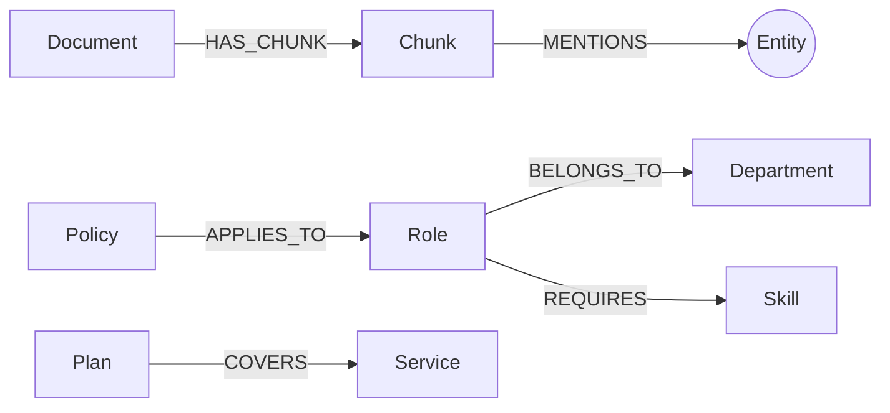
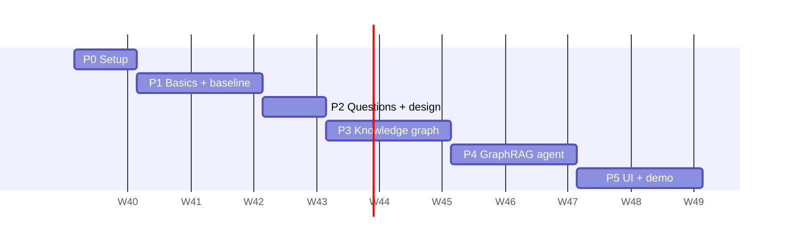

# Project Plan: Zava GraphRAG Agent

| | |
|---|---|
| **Project** | Zava GraphRAG Agent |
| **Goal** | An AI agent that answers employee questions from company documents, using a knowledge graph |
| **Duration** | 10 weeks (adjust to the real internship length) |
| **Team** | Internship lead + interns |
| **Status** | 🟡 Kickoff |

---

## Contents

1. [Overview](#1-overview)
2. [Architecture](#2-architecture)
3. [Work plan](#3-work-plan)
4. [Evaluation](#4-evaluation)
5. [Team and routine](#5-team-and-routine)
6. [Decisions](#6-decisions)
7. [Stretch goals](#7-stretch-goals)

---

## 1. Overview

### 1.1 Problem
Employees at **Zava**, a fictional company, have questions about roles, policies and benefits. The answers are spread across 7 documents. Plain RAG (text search + LLM) struggles when an answer needs **several documents combined**, such as comparisons and "list all…" questions.

### 1.2 Solution
A **GraphRAG agent**:
- Documents are turned into a **knowledge graph** in Neo4j.
- An **agent** in Foundry Agent Service answers questions using **tools** that search the text and the graph.
- Every answer **cites its sources**.

### 1.3 Deliverables

| # | Deliverable | Week |
|---|---|---|
| D1 | Plain RAG agent (baseline) | 3 |
| D2 | Test question set + graph schema | 4 |
| D3 | Knowledge graph, built with one command | 6 |
| D4 | GraphRAG agent + comparison results | 8 |
| D5 | Chat UI, README, final demo | 10 |

### 1.4 In scope / out of scope

| ✅ In scope | ❌ Out of scope |
|---|---|
| Microsoft Foundry (models, agent) | Hosting the app in Azure |
| Azure AI Document Intelligence | Infrastructure as code |
| Neo4j knowledge graph | CI/CD pipelines |
| Streamlit chat UI | Key Vault, Managed Identity |
| Test questions + comparison | Monitoring, production hardening |

---

## 2. Architecture

### 2.1 Components

| # | Component | Service / tool | Runs | Purpose |
|---|---|---|---|---|
| C1 | AI platform | **Microsoft Foundry** project | Azure | Holds models and the agent |
| C2 | Chat model | Foundry model deployment | Azure | Extraction, Text2Cypher, answers |
| C3 | Embedding model | Foundry model deployment | Azure | Turns text into vectors |
| C4 | Agent | **Foundry Agent Service** | Azure | Chooses tools, writes answers |
| C5 | PDF reader | **Azure AI Document Intelligence** (layout model) | Azure | PDF → Markdown with headings, tables, pages |
| C6 | Database | **Neo4j 5** in Docker | Laptop | Knowledge graph + vector index |
| C7 | Code | Python 3.12, uv, `azure-ai-projects`, `neo4j` | Laptop | Build pipeline + agent tools |
| C8 | UI | **Streamlit** | Laptop | Chat page for the demo |

### 2.2 System diagram

### 2.3 Build pipeline

| Step | Action | Tool | Input | Output |
|---|---|---|---|---|
| A1 | Download documents | `download_data.py` | GitHub repo | `data/raw/` |
| A2 | Read PDFs | Document Intelligence | PDF files | Markdown in `data/cache/` |
| A3 | Split into chunks | Python | Markdown | Chunks with document + page |
| A4 | Embed chunks | Embedding model | Chunks | Vectors in `data/cache/` |
| A5 | Extract entities and relationships | Chat model (JSON output) | Chunks | Entities in `data/cache/` |
| A6 | Merge duplicates | Python | Entities | Clean entities |
| A7 | Save to Neo4j | `neo4j` driver (`MERGE`) | Chunks + entities | Graph + vector index |

All steps run with **one command**: `build_graph.py`. Results are cached, so re-runs don't cost again.

### 2.4 Question flow

| Step | What happens |
|---|---|
| B1 | The user asks a question in Streamlit |
| B2 | The agent reads the question and picks one or more tools |
| B3 | Our code runs the tool against Neo4j and returns results with sources |
| B4 | The agent writes the answer from the results and cites the sources |

### 2.5 Agent tools

| Tool | Input | What it does | Returns | Example question |
|---|---|---|---|---|
| `search_documents` | question text | Vector search over chunks | Top chunks + sources | "What is the Health Plus deductible?" |
| `explore_entity` | entity name | Finds the entity and its neighbors in the graph | Facts + source chunks | "What does Health Plus cover?" |
| `query_graph` | question text | LLM writes Cypher, runs it **read-only** with `LIMIT` | Query results + the Cypher | "Which roles require Python?" |

| Agent version | Tools | Purpose |
|---|---|---|
| **Baseline** (plain RAG) | `search_documents` | The score to beat |
| **GraphRAG** | all three | The main system |

### 2.6 Graph model

**Nodes**

| Label | Key property | Created by | Example |
|---|---|---|---|
| `Document` | `name` | Pipeline | `employee_handbook.pdf` |
| `Chunk` | `id` | Pipeline | text + embedding + page |
| `Role` | `name` | LLM | "Software Engineer" |
| `Department` | `name` | LLM | "Engineering" |
| `Skill` | `name` | LLM | "Python" |
| `Policy` | `name` | LLM | "Remote work policy" |
| `Plan` | `name` | LLM | "Northwind Health Plus" |
| `Service` | `name` | LLM | "Dental care" |

**Relationships**

| Relationship | From → To | Meaning |
|---|---|---|
| `HAS_CHUNK` | Document → Chunk | Document contains this chunk |
| `MENTIONS` | Chunk → any entity | Where a fact comes from |
| `BELONGS_TO` | Role → Department | Role is in this department |
| `REQUIRES` | Role → Skill | Role needs this skill |
| `APPLIES_TO` | Policy → Role | Policy applies to this role |
| `COVERS` | Plan → Service | Plan covers this service |

This is the starting point. The team reviews it in week 4 (task P2.3).

### 2.7 Code structure

| Path | Purpose |
|---|---|
| `src/graphrag/config.py` | Reads settings from `.env` |
| `src/graphrag/documents.py` | Document Intelligence: PDF → Markdown → chunks |
| `src/graphrag/models.py` | Foundry models: chat + embeddings |
| `src/graphrag/extract.py` | Entity extraction prompt + call |
| `src/graphrag/graph.py` | Neo4j: save and query |
| `src/graphrag/tools.py` | Agent tools |
| `src/graphrag/agent.py` | Create the Foundry agent, handle tool calls |
| `scripts/download_data.py` | Step A1 |
| `scripts/build_graph.py` | Steps A2–A7 |
| `scripts/ask.py` | Ask the agent from the terminal |
| `app.py` | Streamlit chat UI |
| `evaluation/questions.jsonl` | Test questions |
| `evaluation/run_eval.py` | Runs baseline vs GraphRAG |
| `data/raw/`, `data/cache/` | Documents and saved results (not in git) |
| `docs/` | This plan, graph schema, weekly notes |

---

## 3. Work plan

### 3.1 Phases at a glance

| Phase | Weeks | Name | Deliverable |
|---|---|---|---|
| P0 | 1 | Setup | Working environment |
| P1 | 2–3 | Basics + baseline agent | D1 |
| P2 | 4 | Test questions + graph design | D2 |
| P3 | 5–6 | Knowledge graph | D3 |
| P4 | 7–8 | GraphRAG agent | D4 |
| P5 | 9–10 | UI + demo | D5 |

The start date is a placeholder.

---

### P0: Setup (week 1)

**Goal:** everyone can run Neo4j and call a Foundry model.

| ID | Task | Who | Output |
|---|---|---|---|
| P0.1 | Create the Foundry project, deploy a chat model and an embedding model | Lead | Project endpoint + deployment names |
| P0.2 | Create the Document Intelligence resource | Lead | Endpoint + key |
| P0.3 | Give interns access to the repo and the Foundry project | Lead | Access |
| P0.4 | Install Python 3.12, uv, Docker, Azure CLI, VS Code | All | Working laptop |
| P0.5 | Run Neo4j in Docker, try Cypher at `localhost:7474` | All | Neo4j running |
| P0.6 | Call the Foundry chat model once from Python | All | "Hello" response |
| P0.7 | Read the 7 Zava documents | All | Notes on content |

**Done when:** ✅ P0.5 and P0.6 work on every laptop.

---

### P1: Basics + baseline agent (weeks 2–3)

**Goal:** a plain RAG agent that answers with sources.

| ID | Task | Who | Output |
|---|---|---|---|
| P1.1 | Neo4j GraphAcademy: *Neo4j Fundamentals*, *Cypher Fundamentals* | All | Certificates |
| P1.2 | Try the agent playground in the Foundry portal | All | Understanding of agents |
| P1.3 | Project skeleton: `pyproject.toml`, `config.py`, `.env.example`, `.gitignore` | All | Repo structure |
| P1.4 | `download_data.py` | All | `data/raw/` filled |
| P1.5 | Read PDFs with Document Intelligence, cache the Markdown | All | `data/cache/*.md` |
| P1.6 | Split into chunks, embed, save to Neo4j with a vector index | All | `Document` + `Chunk` nodes |
| P1.7 | `search_documents` tool | All | Working tool |
| P1.8 | First Foundry agent using `search_documents` | All | Baseline agent |
| P1.9 | `ask.py`: ask the agent from the terminal | All | CLI |

**Done when:** ✅ the baseline agent answers Zava questions and cites sources.

---

### P2: Test questions + graph design (week 4)

**Goal:** agree on how to measure success and what goes in the graph.

| ID | Task | Who | Output |
|---|---|---|---|
| P2.1 | Write 20–30 test questions with expected answers (see §4) | All | `evaluation/questions.jsonl` |
| P2.2 | Run the baseline agent on them, score the answers | All | Baseline scores |
| P2.3 | Review the graph model (§2.6) against the documents | All | Updated model |
| P2.4 | Document the graph model | All | `docs/graph-schema.md` |
| P2.5 | Review questions and schema with the lead | Lead + all | Approval |

**Done when:** ✅ test questions, baseline scores and graph schema are approved.

---

### P3: Knowledge graph (weeks 5–6)

**Goal:** documents turned into a correct, traceable graph.

| ID | Task | Who | Output |
|---|---|---|---|
| P3.1 | Extraction prompt with JSON output, limited to the schema | Track A | Prompt |
| P3.2 | Run extraction on all chunks, cache the results | Track A | `data/cache/entities` |
| P3.3 | Merge duplicates (e.g. "Health Plus" = "Northwind Health Plus") | Track A | Clean entities |
| P3.4 | Save entities and relationships with `MERGE` | Track A | Domain graph |
| P3.5 | Link entities to chunks (`MENTIONS`) | Track A | Traceable facts |
| P3.6 | `build_graph.py`: whole pipeline in one command | Track A | Script |
| P3.7 | Check 20 random facts against the documents | Track B | Quality notes |
| P3.8 | Draft Cypher queries for the test questions by hand | Track B | Example queries for P4 |

**Done when:** ✅ `build_graph.py` rebuilds the graph from scratch, and the fact check in P3.7 passes.

---

### P4: GraphRAG agent (weeks 7–8)

**Goal:** the agent uses the graph and beats the baseline.

| ID | Task | Who | Output |
|---|---|---|---|
| P4.1 | `explore_entity` tool | Track A | Working tool |
| P4.2 | `query_graph` tool (Text2Cypher, read-only, `LIMIT`) | Track A | Working tool |
| P4.3 | GraphRAG agent with all three tools, instructions and citation rules | Track B | GraphRAG agent |
| P4.4 | Check which tools the agent calls for each question (Foundry portal) | Track B | Tool usage notes |
| P4.5 | `run_eval.py`: run baseline and GraphRAG on all test questions | Track B | Results table |
| P4.6 | Improve the weakest part, measure again | All | Better scores |

**Done when:** ✅ GraphRAG scores higher than the baseline on comparison and list questions.

---

### P5: UI + demo (weeks 9–10)

**Goal:** a working demo and clear documentation.

| ID | Task | Who | Output |
|---|---|---|---|
| P5.1 | Streamlit chat: answer, sources, tools used | Track A | `app.py` |
| P5.2 | Switch in the UI: baseline agent vs GraphRAG agent | Track A | Side-by-side demo |
| P5.3 | README: setup and run instructions | Track B | Updated README |
| P5.4 | Results summary: scores, what worked, what didn't | Track B | `docs/results.md` |
| P5.5 | Final presentation + live demo | All | Demo |

**Done when:** ✅ the demo runs live and a new person can set up the project from the README.

---

## 4. Evaluation

### 4.1 Question set
File: `evaluation/questions.jsonl`. Fields: `id`, `question`, `type`, `expected_answer`, `source_document`.

| Type | Example | Count |
|---|---|---|
| Simple fact | "What is the deductible of Health Plus?" | ~8 |
| Comparison | "What does Health Plus cover that Standard doesn't?" | ~6 |
| List / count | "Which roles require Python?" | ~6 |
| Not in the documents | "What is Zava's stock price?" | ~4 |

> Write the questions **before** building the graph (P2), so they aren't tuned to it.

### 4.2 Scoring

| Check | Values |
|---|---|
| Answer | ✅ correct / 🟡 partly correct / ❌ wrong |
| Sources | Right document cited? yes / no |
| Tool choice | Sensible tool used? yes / no (GraphRAG only) |

Score by hand, or let the chat model compare the answer with the expected answer.

### 4.3 Results table (template)

| Question type | Baseline correct | GraphRAG correct |
|---|---|---|
| Simple fact | _ / 8 | _ / 8 |
| Comparison | _ / 6 | _ / 6 |
| List / count | _ / 6 | _ / 6 |
| Not in the documents | _ / 4 | _ / 4 |
| **Total** | **_ / 24** | **_ / 24** |

---

## 5. Team and routine

### 5.1 Tracks

| Weeks | Setup |
|---|---|
| 1–4 | Everyone works together on the same tasks |
| 5–10 | **Track A:** knowledge graph and tools. **Track B:** agent, evaluation and docs |

With few interns, one person can cover both tracks.

### 5.2 Routine

| What | When | Who |
|---|---|---|
| Check-in | Daily, 15 min | All |
| Demo + review | Weekly | All + lead |
| Weekly note (`docs/weekly/`) | Weekly | Each track |
| Pull request review | Every PR | One other intern |

### 5.3 Working rules
- Small pull requests, one topic each.
- Never commit `.env` or keys.
- Cache Document Intelligence and LLM results in `data/cache/`.
- Generated Cypher always runs read-only.

---

## 6. Decisions

| # | Decision | Options | Recommendation | When |
|---|---|---|---|---|
| X1 | Dates and team | | | Before P0 |
| X2 | Azure region | EU regions | An EU region with the needed models | Before P0 |
| X3 | Chat + embedding models | Foundry model catalog | A small, cheap chat model to start | P0 |
| X4 | Agent SDK | `azure-ai-projects` / Microsoft Agent Framework | **`azure-ai-projects`**: agent and tool calls are visible in the Foundry portal | P1 |
| X5 | GraphRAG code | Plain Python / `neo4j-graphrag` | **Plain Python**: every step is visible | P1 |

Check the current [Foundry function calling docs](https://learn.microsoft.com/azure/foundry/agents/how-to/tools/function-calling) before starting P1. The SDK changes often.

---

## 7. Stretch goals

Only after all P0–P5 tasks are done.

| # | Goal | Adds |
|---|---|---|
| S1 | Foundry evaluations | Automatic scoring (groundedness, relevance) |
| S2 | Second agent (e.g. benefits specialist) | Multi-agent handover |
| S3 | Team-written documents (org chart, project list) | A bigger graph |
